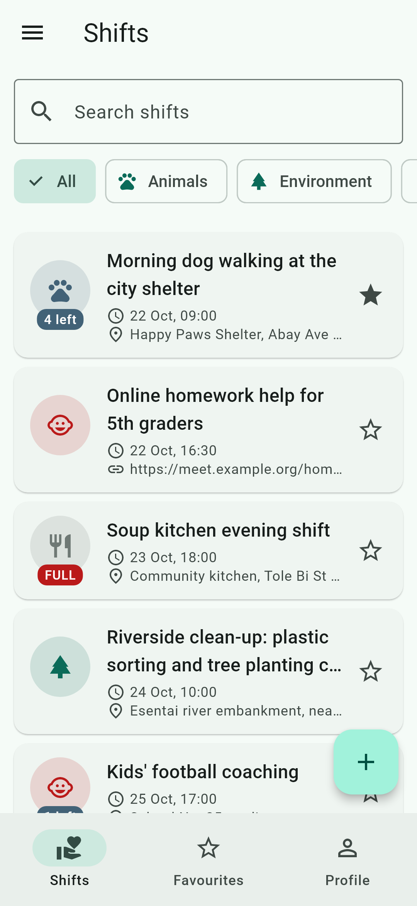
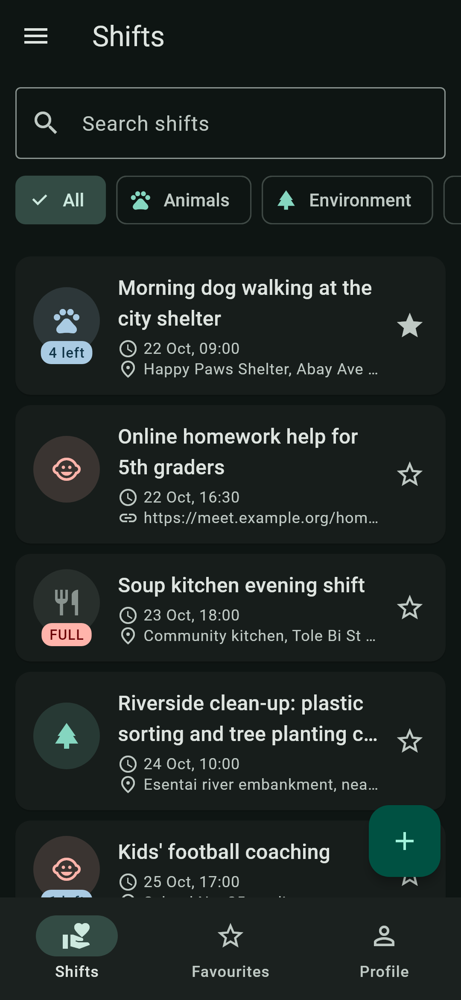
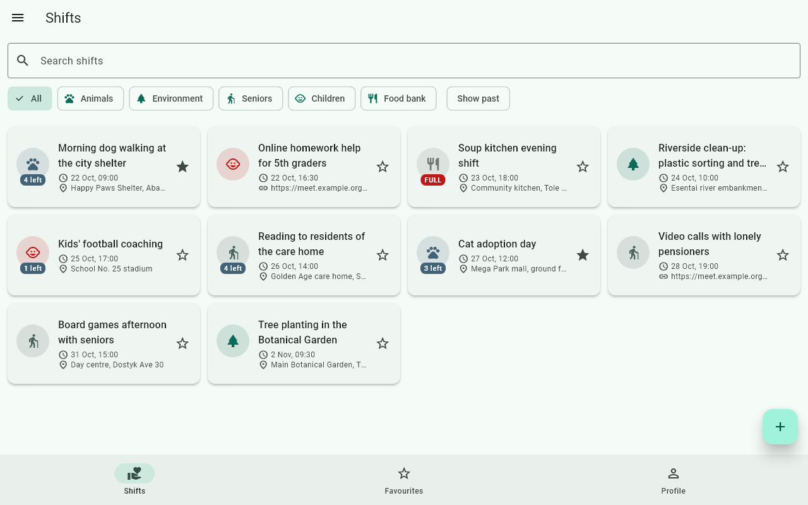

# Volunteer Shifts

Lab 1, Mobile Development.

An app for volunteering shifts in the city. Every shift has a title, a cause
(animals, environment, seniors, children, food bank), a start time, a number of
places and a list of people who signed up. A shift can be online, then its place
is a meeting link instead of an address. You can add shifts to favourites, sign
up with your name from the profile and cancel later. All data is kept in memory.

| Phone, light | Phone, dark | Tablet, grid |
| --- | --- | --- |
|  |  |  |

## Decisions

The shifts list and the profile are stored in the shell's `State`, and the tabs
get them as parameters and send changes back with callbacks. The detail screen
is pushed on top of the shell, so the shell's `setState` does not rebuild it,
that is why it gets the shift and callbacks in its route arguments. The form
only creates one value, so it just returns the `Shift` with `Navigator.pop` and
the caller checks for `null` and `mounted` before `setState`. I used
`LayoutBuilder` for the grid because it looks at the width the list really has,
not the whole screen like `MediaQuery`. `PopScope` compares a record of the
current form values with the record saved when the form opened, so one `!=`
shows if there are unsaved changes. With week 9's tools I would move the state
into a `ChangeNotifier` and save it to storage, so the detail screen would not
need callbacks.
