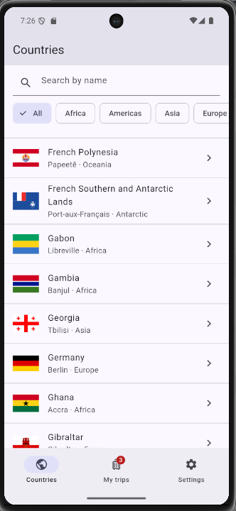
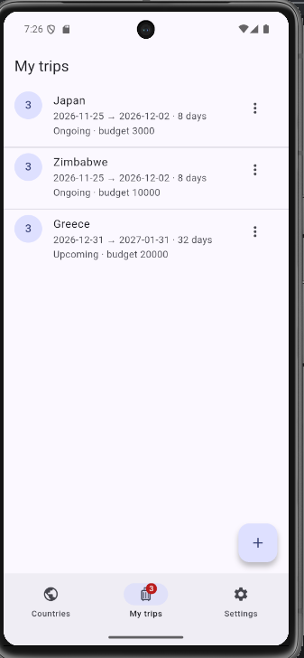

# Trip Planner — Lab 2

A travel planner: browse countries from the public **REST Countries** API and keep
your own **trips** (country, dates, budget, rating, notes) on a **MockAPI.io** backend
with full create / read / update / delete. Works offline with the last saved
catalogue and runs completely without network on fake repositories.

| Countries | My trips |
| --- | --- |
|  |  |

## Run

```sh
flutter pub get

# offline, on Fake… repositories (the defence mode)
flutter run --dart-define=USE_FAKES=true

# against REST Countries v5 + MockAPI.io
# (copy env/keys.example.json to env/keys.json and put your free key in it)
flutter run --dart-define-from-file=env/prod.json --dart-define-from-file=env/keys.json

# release APK
flutter build apk --release --split-per-abi --obfuscate \
  --split-debug-info=symbols/1.0.3 --dart-define-from-file=env/prod.json   --dart-define-from-file=env/keys.json
```

Demo sign-in: any email, password `travel123`.

## Architecture

1. `lib/core/` — `ApiClient` (the wire), sealed `ApiException`, `SecureStore`, `Env`, routes, shared state widgets.
2. `lib/features/<name>/` — `countries`, `trips`, `account`; each has models, repositories, a `ChangeNotifier`, screens.
3. Every repository is an `abstract interface class` with an `Http…` and a `Fake…` implementation.
4. `main.dart` is the composition root: it picks `Http…` or `Fake…` by `USE_FAKES` and provides the notifiers.
5. Screens `watch` notifiers, call them in callbacks with `read`, and switch on `ApiException` exhaustively.

## Tests

**60 tests**, all offline, about 3 seconds: `flutter test`.

## Quality

```
$ flutter analyze
Analyzing lab_2...
No issues found!

$ dart format .
Formatted 74 files (0 changed)

$ sh tool/check_layers.sh
(no output)
```

## Team

| Area | Owner |
| --- | --- |
| countries, trips, account, core, tests, release | Daulet |

Details in [TEAM.md](TEAM.md).

## Decisions

- Two hosts mean two `ApiClient` objects built in `main.dart`, and only the MockAPI one gets the `SecureStore`, so the token never leaves for a public API. (Daulet)
- `ApiClient` returns decoded JSON instead of `http.Response`, so `package:http` lives only in `core/api` and `tool/check_layers.sh` stays silent. (Daulet)
- The six `ApiException` subclasses are `part` files of one library, because a sealed class can only be extended inside its own library and we keep one class per file. (Daulet)
- Models read JSON through `JsonRead.read<T>`, so a wrong type becomes a `FormatException` that names the field, and the repository turns it into `BadResponseException('trips: field "budget" …')`. (Daulet)
- The catalogue searches through `/countries/v5/name?q=` and filters through `/countries/v5/region/{r}` with a `response_fields` list, never fetching everything and filtering in Dart. (Daulet)
- REST Countries shut down v3.1, so the catalogue moved to v5; its free API key is a `--dart-define` from the gitignored `env/keys.json` and goes in the `Authorization` header of the catalogue client only. (Daulet)
- `CountriesModel` numbers its requests and drops an answer that is older than the latest search, so fast typing never shows stale results. (Daulet)
- The trips list is reloaded from the server after every create, update and delete, so it shows the server's answer and not a local guess. (Daulet)
- The country detail creates its `Future` once in `initState` and shows it through a `FutureBuilder`, so popping mid-load leaves nothing to `setState` on. (Daulet)
- Routes that return a value are typed (`MaterialPageRoute<Trip>`), because `pushNamed<Trip>` casts the route and a `Route<dynamic>` fails silently in release. (Daulet)
- Save leaves the form with `Navigator.pop`, which ignores `PopScope`, so only Back on a dirty form asks. (Daulet)
- Sign-in is fake with the demo password `travel123`: the course has no auth server, and the token still goes through `flutter_secure_storage` and the `Authorization` header. (Daulet)

## Pre-release checklist

- [x] 1. `flutter analyze` — 0 issues (see Quality).
- [x] 2. `dart format .` — no diff (see Quality).
- [x] 3. `flutter test` — 60 green, offline.
- [x] 4. `tool/check_layers.sh` prints nothing.
- [x] 5. `applicationId` is `com.dkonakbayev.tripplanner`; `minSdk`, `versionCode`, `versionName` come from `flutter.*` (`android/app/build.gradle.kts`).
- [x] 6. `version:` bumped to `1.0.3+4` (`pubspec.yaml`, `CHANGELOG.md`).
- [x] 7. Release signed with our own keystore — `docs/keytool-printcert.txt`.
- [x] 8. `key.properties` and `*.jks` are gitignored and not in history — `git log --all -- '*.jks' 'key.properties'` is empty.
- [x] 9. `lib/core/env.dart` is the only `fromEnvironment`; `env/prod.json` exists.
- [x] 10. About shows `1.0.3 (4)`, `release`, `Env.name`, `Env.host`.
- [x] 11. Own adaptive icon, Android 12 splash, app name "Trip Planner".
- [x] 12. Manifest has `INTERNET` and `CAMERA` only; iOS has camera and photo-library usage strings.
- [ ] 13. APK built with `--release --split-per-abi --obfuscate --split-debug-info`, symbols archived in `symbols/1.0.3` — proof: release asset.
- [ ] 14. arm64 APK installed from the file on a real phone over mobile data — proof: photo / screen recording.
